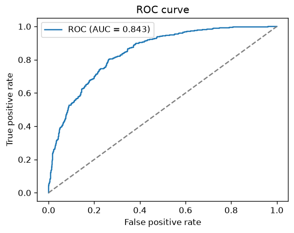
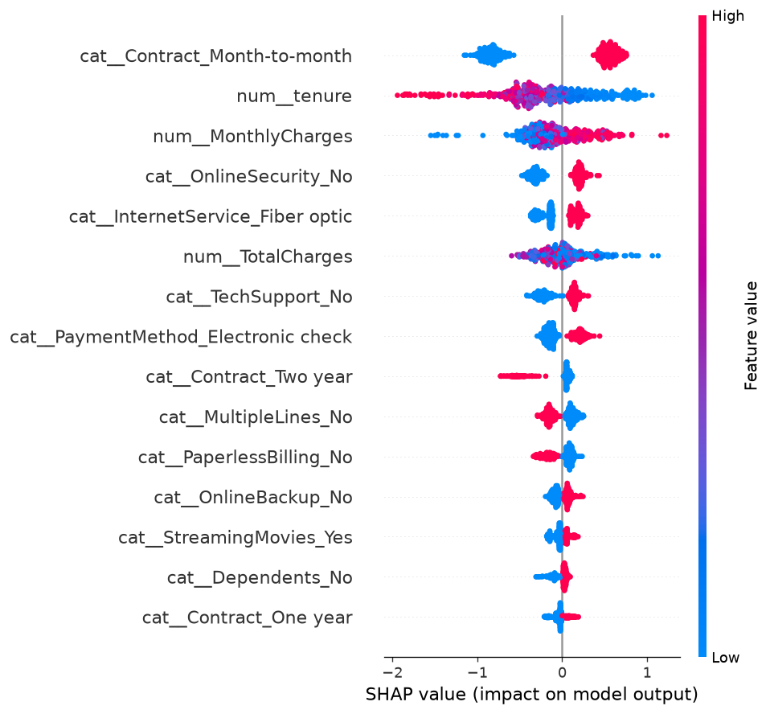

# Customer Churn Intelligence 📉

**Production-aware churn prediction on the Telco dataset: a tested, reproducible pipeline
from raw data → preprocessing → models → evaluation → explainability.**


> Author: **Gaiska Salomón** — predicts which telecom customers are likely to churn and
> explains *why*, so retention teams can act on the right drivers.

---

## What it does

1. **Data** — loads the Telco customer-churn dataset; cleans the known `TotalCharges`
   blank-string issue and encodes the target.
2. **Preprocessing** — a leakage-safe `ColumnTransformer` (median-impute + scale numeric,
   most-frequent-impute + one-hot categorical), fit on the training split only.
3. **Models** — a **Logistic Regression** baseline and an **XGBoost** model, compared on a
   held-out stratified test set.
4. **Evaluation** — ROC-AUC, PR-AUC, F1, precision, recall, accuracy + ROC / PR /
   confusion-matrix plots. The best model and a metrics report are saved.
5. **Explainability** — **SHAP** summary of the top churn drivers.

The whole thing is covered by **unit tests** (`pytest`) and runs end to end with one command.

## Quickstart

```bash
python -m venv .venv && source .venv/Scripts/activate   # Windows Git Bash
pip install -r requirements.txt && pip install -e .

pytest -q              # run the test suite
python -m churn.train  # full pipeline: train, evaluate, save model + figures
```

The dataset is bundled in `data/raw/`; to re-fetch it: `python scripts/get_data.py`.

## Results

Stratified 80/20 split (7,043 customers: ~5,634 train / ~1,409 test), threshold 0.5, single seed. Metrics are written to `reports/metrics.json` and
figures to `reports/figures/`.

| Model | ROC-AUC | PR-AUC | F1 | Precision | Recall |
|---|---|---|---|---|---|
| Logistic Regression (baseline) | 0.841 | 0.633 | 0.614 | 0.504 | **0.783** |
| **XGBoost** (best) | **0.843** | **0.658** | 0.587 | **0.663** | 0.527 |

Both models separate churners well (ROC-AUC ≈ 0.84 on held-out data). The choice depends on
the business goal: the **balanced Logistic Regression** maximizes **recall (0.78)** — catching
more churners — while **XGBoost** is more **precise (0.66)** and accurate. Threshold can be
tuned in `churn.train --threshold` to trade precision for recall.




*(Figures and `reports/metrics.json` are generated by `python -m churn.train`.)*

## Project layout

```
customer-churn-intelligence/
├── src/churn/
│   ├── data.py         # load + clean
│   ├── features.py     # leakage-safe preprocessing (ColumnTransformer)
│   ├── model.py        # pipeline factory (logreg / xgboost)
│   ├── evaluate.py     # metrics + ROC/PR/confusion plots
│   ├── explain.py      # SHAP summary
│   └── train.py        # end-to-end CLI
├── tests/              # pytest: data, features, model
├── scripts/get_data.py # dataset downloader
├── data/raw/           # bundled Telco dataset
└── reports/figures/    # generated plots
```

## Tech stack

Python · pandas · scikit-learn · XGBoost · SHAP · matplotlib · pytest.

## Limitations

- Single public dataset (IBM Telco) and a single train/test split: no cross-validation or
  confidence intervals, so small differences between the two models (e.g. ROC-AUC 0.841 vs 0.843)
  are not statistically meaningful.
- Threshold fixed at 0.5 and no cost-sensitive tuning; the precision/recall trade-off depends on
  a business cost model that is not part of this project.
- Static snapshot: no temporal validation, drift monitoring or deployment.

## License

MIT.
